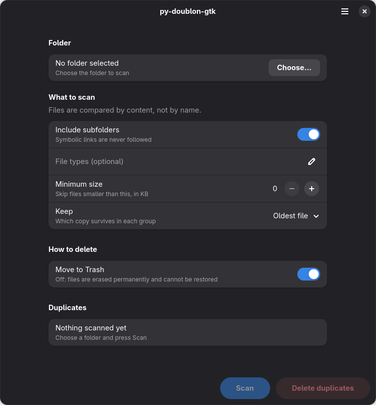

# py-doublon-gtk

A small Python GTK4 + libadwaita desktop app for finding duplicate files in a folder
and moving the extra copies to Trash.

Files are compared by content using SHA-256, with a size pre-filter, rather than by name.
One copy of every group is kept. Symbolic links are neither followed nor deleted.



## Setup

Install `uv`, Python 3.14 or newer, and the system packages for PyGObject, GTK4 (4.10+)
and libadwaita (1.6+). On Fedora:

```sh
sudo dnf install python3-gobject gtk4 libadwaita
./scripts/bootstrap.sh
```

On Debian/Ubuntu, the equivalent packages are `python3-gi`, `gir1.2-gtk-4.0` and
`gir1.2-adw-1`. Your distribution must provide the required Python and library versions.

The bootstrap script creates `.venv` with `--system-site-packages`, which is required for
the app to use the system `gi` module. It defaults to `/usr/bin/python3.14`; override
`PYTHON` if your system PyGObject uses a newer interpreter. Re-run the script instead of
using a bare `uv venv` if you recreate the environment.

Run the app with:

```sh
uv run py-doublon-gtk
```

## Use

Choose a folder and press **Scan**. The window opens with all startup controls visible.
Long scan results can be scrolled and expanded to inspect the extra copies.

- Subfolders are included by default; turn off **Include subfolders** to scan only the
  selected folder.
- **File types** accepts comma-separated extensions, such as `jpg, png`. Empty means all.
- **Minimum size** excludes files smaller than the selected size in KB (1 KB = 1,000 bytes).
- **Keep** chooses the oldest file, newest file, or shortest path in each duplicate group.

Files are moved to Trash by default, and nothing is removed until you confirm. Turning
off **Move to Trash** opts into permanent deletion; its confirmation defaults to Cancel.
If the filesystem does not support Trash (including `/tmp` on tmpfs and some network or
removable drives), the app offers permanent deletion as a separate confirmation.

## Develop

```sh
uv run ruff format .
uv run ruff check .
uv run pyright
uv run pytest -q
```

Models and scanning logic do not import `gi`, so unit tests need no display or session bus.
